<div align="center">


<br/>

**Full-Stack Developer from Egypt** — I build websites, web apps, and the AI layers inside them.
Currently deepening advanced AI integration and full-stack engineering.

<br/>

[](https://aslamalkarywk7.github.io/aslamalkarywk7/)
[](https://github.com/aslamalkarywk7)
[](https://www.linkedin.com/in/islam-elnashar/)
[](https://huggingface.co/ISLAM-PO)
[](mailto:aslamalkarywka@gmail.com)

[](https://aslamalkarywk7.github.io/aslamalkarywk7/)

</div>

---

## 🧭 Quick Profile

<table>
<tr>
<td width="52%" valign="top">

<strong>💼 What I do</strong><br/>
Full-Stack Developer (Next.js / TypeScript / Prisma) building websites &amp; web applications — with AI integration and site hardening as supporting skills.<br/><br/>

<strong>📍 Where I am</strong><br/>
Egypt · MIS undergraduate (3rd year, expected 2029) · self-taught alongside formal study<br/><br/>

<strong>🗣️ Languages</strong><br/>
Arabic (native) · English (technical) · Spanish (basic)<br/><br/>

<strong>📬 Reach me</strong><br/>
<a href="mailto:aslamalkarywka@gmail.com">aslamalkarywka@gmail.com</a> ·
<a href="https://github.com/aslamalkarywk7">GitHub</a> ·
<a href="https://www.linkedin.com/in/islam-elnashar/">LinkedIn</a>

</td>
<td width="48%" valign="top">

<strong>✅ Open to</strong><br/>
Full-time Full-Stack roles <strong>and</strong> freelance projects — business sites, stores, custom web apps, plus a large-scale AI project in progress.<br/><br/>

<strong>🎯 Curiosity</strong><br/>
Web development · game programming · AI research · defensive security<br/><br/>

<strong>💬 Ask me anything</strong><br/>
Open an issue →
<a href="https://github.com/aslamalkarywk7/aslamalkarywk7/issues">github.com/aslamalkarywk7/issues</a><br/><br/>

<strong>⚡ Currently</strong><br/>
Deepening advanced AI integration and full-stack web development.

</td>
</tr>
</table>

---

## 🛠️ What You Can Hire Me For

<table>
<tr>
<td width="50%" valign="top">

<strong>🌐 Websites, Portfolios &amp; Stores</strong><br/>
Business sites, personal portfolios, company sites and small online stores.<br/>
<em>Stack</em> — React · Next.js · Node.js · TypeScript · Prisma · PostgreSQL · Tailwind<br/><br/>

<strong>🤖 Arabic-First AI For Your Site</strong><br/>
Chat assistants, content generation and translation — wired into the product, not a side experiment.<br/>
<em>Stack</em> — LLM APIs (OpenAI / Gemini / Groq) · LangChain · vector search · prompt design

</td>
<td width="50%" valign="top">

<strong>🔒 Website Hardening</strong><br/>
Audits, fixes and monitoring against common attacks. I harden my own production sites — I am not a pentester for hire.<br/>
<em>Stack</em> — OWASP Top 10 · security headers · input validation · rate limiting · CI checks<br/><br/>

<strong>🐧 Linux &amp; Deployment</strong><br/>
Shipping Next.js apps: pipelines, containers, servers, TLS, logs and rollback.<br/>
<em>Stack</em> — Bash · Docker · GitHub Actions · Nginx · Vercel / Netlify

</td>
</tr>
</table>

---

## 💪 Skills, proven

**Every claim below links to its evidence.** Nothing here is a self-assessment.

<div align="center">

[](https://github.com/aslamalkarywk7?tab=followers)
[](https://github.com/aslamalkarywk7?tab=repositories)
[](https://github.com/aslamalkarywk7/aslamalkarywk7/commits/main)
[](LICENSE)

</div>

<table>
<tr>
<td width="50%" valign="top">

<strong>🖥️ Full-stack engineering</strong><br/>
Next.js 14 App Router · TypeScript · Prisma · PostgreSQL · Tailwind — shipped in production, not tutorial exercises.<br/>
<em>Evidence</em> → <a href="docs/full-stack.md">18 live web apps, screenshots &amp; pinned versions</a> · <a href="https://github.com/aslamalkarywk7/islam-elite-portfolio">islam-elite-portfolio</a><br/><br/>

<strong>🤖 AI integration (Arabic-first)</strong><br/>
Three models and four datasets published on Hugging Face; LLMs wired into real product features — chat, content, translation.<br/>
<em>Evidence</em> → <a href="https://huggingface.co/ISLAM-PO">huggingface.co/ISLAM-PO</a> · <a href="docs/ai-integrations.md">docs/ai-integrations.md</a><br/><br/>

<strong>🌍 Open source at scale</strong><br/>
Pull requests opened into codebases owned by Microsoft and Google, with maintainer reviews.<br/>
<em>Evidence</em> → <a href="https://github.com/microsoft/markitdown/pull/2538">microsoft/markitdown#2538 ✅ approved</a> · <a href="https://github.com/google/adk-python/pull/7198">google/adk-python#7198</a> · <a href="https://github.com/genkit-ai/genkit/pull/6386">genkit-ai/genkit#6386</a>

</td>
<td width="50%" valign="top">

<strong>🔒 Security engineering</strong><br/>
OWASP-aware hardening applied to my own production apps — server-side validation, HttpOnly sessions, rate limiting, least privilege, dependency audits.<br/>
<em>Evidence</em> → <a href="docs/defensive-security.md">docs/defensive-security.md</a> · <a href="https://github.com/aslamalkarywk7/AndroidReverseEngineering-Guide">AndroidReverseEngineering-Guide</a> (most-starred)<br/><br/>

<strong>🐧 DevOps &amp; delivery</strong><br/>
Docker · GitHub Actions · Nginx · Vercel — pipelines, container images, TLS, logs and rollback.<br/>
<em>Evidence</em> → <a href="docs/linux-systems.md">docs/linux-systems.md</a><br/><br/>

<strong>🎓 Verified, documented learning</strong><br/>
25 certificates — Full Stack Open (University of Helsinki, 5 ECTS, grade 1), OneRoadmap, Google Cloud, Simplilearn, and 17 Kaggle micro-courses.<br/>
<em>Evidence</em> → <a href="docs/certificates.md">docs/certificates.md</a> (with PDF originals)

</td>
</tr>
</table>

### 🧭 How I work — the professional part

| | |
|---|---|
| **Method** | Reproduce → isolate → read the source, not guesses → smallest fix → regression test → document. Evidence before synthesis, always. |
| **Standards** | Conventional Commits · semantic versioning · MIT licensing with attribution · CI green before merge · docs-as-code · WCAG basics (labels carry meaning, never colour alone) · OWASP awareness |
| **AI policy** | AI-assisted, human-reviewed: the AI drafts, **I** verify, test, and take responsibility for every merged line. No unreviewed generated code in production. |
| **Honesty** | Production stack vs. explored stack are labelled separately — including in the AI assistant on this site, which is told to say "not documented" rather than guess. |
| **Openness** | Ask me anything → [GitHub Issues](https://github.com/aslamalkarywk7/aslamalkarywk7/issues) · full detail in [docs/qa.md](docs/qa.md) |

---

## ⚡ Tech Stack

<table>
<tr>
<td width="50%" valign="top">

<strong>Core production stack</strong><br/>
<code>TypeScript</code> <code>JavaScript</code> <code>Next.js</code> <code>React</code> <code>Node.js</code> <code>Prisma</code><br/>
<code>PostgreSQL</code> <code>SQLite</code> <code>Tailwind CSS</code> <code>Sass</code> <code>tRPC</code> <code>Express.js</code> <code>REST APIs</code><br/>
<code>Git</code> <code>GitHub Actions</code> <code>Docker</code> <code>Nginx</code> <code>Vercel</code> <code>Netlify</code> <code>Linux</code> <code>Bash</code><br/><br/>

<strong>Data &amp; AI</strong><br/>
<code>Python</code> <code>Pandas</code> <code>NumPy</code> <code>TensorFlow</code> <code>PyTorch</code> <code>Ollama</code> <code>LLaMA</code> <code>Qwen</code><br/>
<code>Gemma</code> <code>LangChain</code> <code>Vector Search</code> <code>Playwright</code> <code>Puppeteer</code>

</td>
<td width="48%" valign="top">

<strong>Explored / familiar — not production</strong><br/>
<code>OutSystems</code> <code>Webflow</code> <code>Power BI</code> <code>Power Automate</code> <code>ARIS</code> <code>Budibase</code> <code>Visual Basic</code> <code>AngularJS</code><br/><br/>

<strong>Tools &amp; design</strong><br/>
<code>Figma</code> <code>Photoshop</code> <code>GIMP</code> <code>VS Code</code> <code>Cursor</code> <code>Postman</code> <code>Obsidian</code> <code>Excalidraw</code> <code>DaVinci Resolve</code> <code>Audacity</code><br/><br/>

<strong>Game engine (curiosity)</strong><br/>
<code>Unity</code> <code>C#</code> <code>PlayFab</code> <code>Blender</code><br/><br/>

📖 <a href="docs/tech-stack.md"><strong>docs/tech-stack.md</strong></a> — the full map, production vs. explored, all 40 languages.

</td>
</tr>
</table>

---

## 🤖 AI Work

**Hugging Face** — [ISLAM-PO](https://huggingface.co/ISLAM-PO)

| Models | Datasets |
|---|---|
| [MasryGPT-Chat-1.5B](https://huggingface.co/ISLAM-PO/MasryGPT-Chat-1.5B) — Egyptian Arabic chat | [arabic-history-and-dialects](https://huggingface.co/datasets/ISLAM-PO/arabic-history-and-dialects) |
| [MasryGPT-Flash-Adapter](https://huggingface.co/ISLAM-PO/MasryGPT-Flash-Adapter) — lightweight LoRA | [arabic-to-code-8-langs-3m](https://huggingface.co/datasets/ISLAM-PO/arabic-to-code-8-langs-3m) |
| [Glitch-Img-1.0](https://huggingface.co/ISLAM-PO/Glitch-Img-1.0) — image generation | [documents-Egyptian-Arabic](https://huggingface.co/datasets/ISLAM-PO/documents-Egyptian-Arabic) |
| | [arab-dialects-20-countries-3m](https://huggingface.co/datasets/ISLAM-PO/arab-dialects-20-countries-3m) |

📖 [docs/ai-integrations.md](docs/ai-integrations.md)

---

## 💬 This Site Has Its Own AI Assistant

Bottom-right corner of the portfolio — English / العربية. It is **not** a generic chatbot: it answers from a knowledge base that lives in this repository, so it cannot invent credentials, clients or numbers.

| | |
|---|---|
| **Grounded** | tools retrieve verified facts — this repo's `README.md` + `docs/`, the certificate catalogue, his services, live GitHub numbers |
| **Honest** | the prompt forbids inventing employers, dates, tools or certificates — it says "not documented" instead of guessing |
| **Private** | the API key never reaches the browser; it lives only in the server environment |
| **Extensible** | the same tool layer is published as a **standalone MCP server** — Claude Desktop, Cursor or any MCP client can query it |

```json
{ "mcpServers": { "portfolio": { "command": "node",
  "args": ["/path/to/aslamalkarywk7/mcp/server.mjs"] } } }
```

📖 [docs/ai-integrations.md](docs/ai-integrations.md#6-ai-assistant-on-this-portfolio) · [docs/mcp.md](docs/mcp.md)

---

## ⭐ Featured Work

- **[islam-elite-portfolio](https://github.com/aslamalkarywk7/islam-elite-portfolio)** — 18 live web projects, demos included
- **[AndroidReverseEngineering-Guide](https://github.com/aslamalkarywk7/AndroidReverseEngineering-Guide)** — ⭐ most-starred guide in the account (defensive security research)
- **[TurboQuant](https://github.com/aslamalkarywk7/TurboQuant)** — lossless compression for every file type, plus a web console
- **[Full-Stack proof page](docs/full-stack.md)** — backend + 18 sites + 65 designs, with screenshots and pinned versions

## 🌍 Open-Source Contributions

| Pull request | Status |
|---|---|
| [microsoft/markitdown#2538](https://github.com/microsoft/markitdown/pull/2538) | ✅ approved, awaiting merge |
| [microsoft/markitdown#2539](https://github.com/microsoft/markitdown/pull/2539) | 🟡 open, awaiting review |
| [google/adk-python#7198](https://github.com/google/adk-python/pull/7198) | 🟡 open |
| [genkit-ai/genkit#6386](https://github.com/genkit-ai/genkit/pull/6386) | 🟡 feedback addressed |
| [genkit-ai/genkit#6387](https://github.com/genkit-ai/genkit/pull/6387) | 🟡 feedback addressed |

🎯 **Goal** — first merged PRs at Microsoft & Google. One approval already secured.
📖 [Read the full story](CONTRIBUTIONS.md)

---

## 🎓 Certificates

<!-- CERTS:START -->
> All 25 certificates below are generated from the same catalogue the website renders (`data/certificates.mjs`) — the docs and the site can never drift apart. Regenerate with `node scripts/build-cert-docs.mjs`.

### Full-Stack Development

<p align="center"><a href="https://studies.cs.helsinki.fi/stats/api/certificate/fullstackopen/en/8adba106796fd6c41b4136dc41ecc601">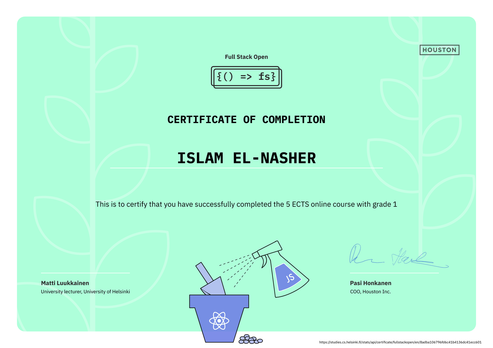</a></p>
<p align="center"><sub><i>University of Helsinki · 5 ECTS, grade 1 — JavaScript, TypeScript, React, Node.js, databases and deployment.</i></sub></p>

<p align="center"><a href="https://www.oneroadmap.io/skills/fs/certificate/CERT-90CAE102">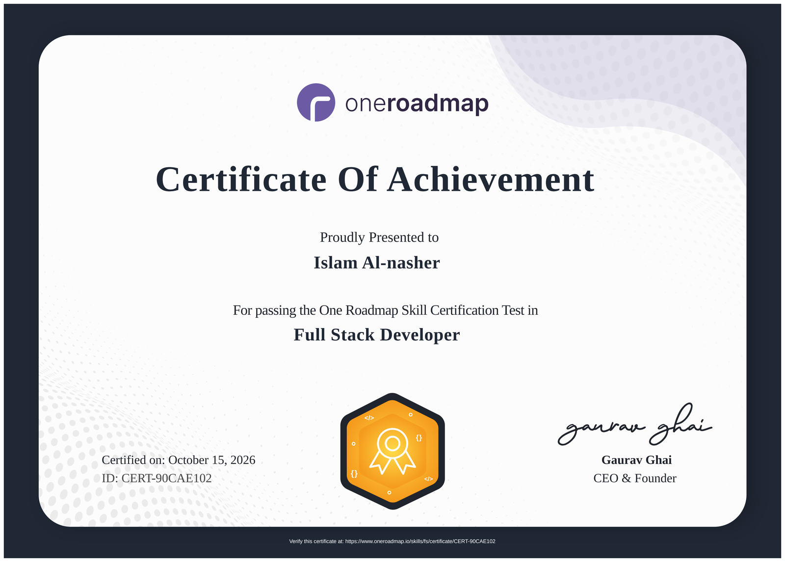</a></p>
<p align="center"><sub><i><a href="certificates/oneroadmap-full-stack-developer.pdf">PDF original</a></i></sub></p>
<p align="center"><sub><i>OneRoadmap · Practical full-stack skill test — APIs, front-end, databases and DevOps workflow.</i></sub></p>

<p align="center">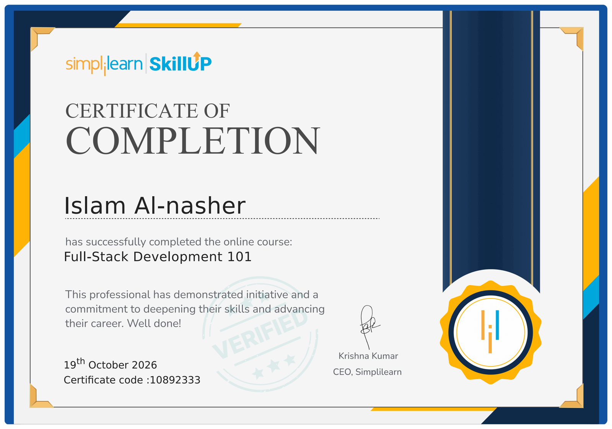</p>
<p align="center"><sub><i><a href="certificates/simplilearn-full-stack-development-101.pdf">PDF original</a></i></sub></p>
<p align="center"><sub><i>Simplilearn SkillUP · Building modern web applications from front-end to back-end.</i></sub></p>

### AI &amp; Machine Learning

<p align="center"></p>
<p align="center"><sub><i><a href="certificates/simplilearn-tensorflow-for-beginners.pdf">PDF original</a></i></sub></p>
<p align="center"><sub><i>Simplilearn SkillUP · Building and training neural networks with TensorFlow.</i></sub></p>

<p align="center">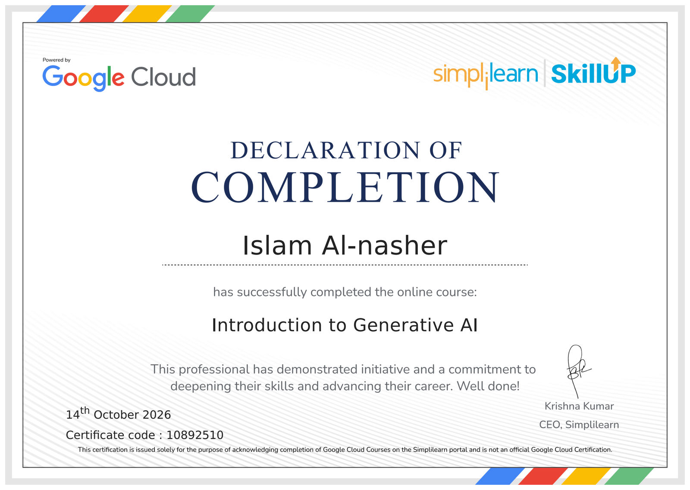</p>
<p align="center"><sub><i><a href="certificates/google-cloud-introduction-to-generative-ai.pdf">PDF original</a></i></sub></p>
<p align="center"><sub><i>Google Cloud · Foundations of generative models, prompts and LLM applications.</i></sub></p>

### Data &amp; Analytics — Kaggle Micro-Courses

<p align="center">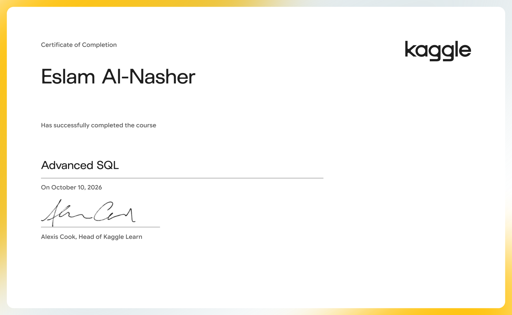</p>
<p align="center"><sub><i>Kaggle · SQL for data analysis — aggregations, joins and window functions.</i></sub></p>

<p align="center">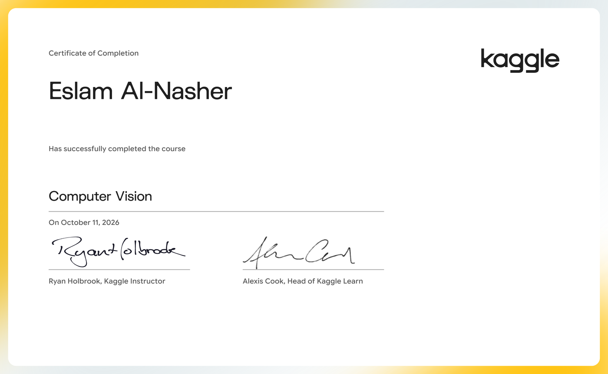</p>
<p align="center"><sub><i>Kaggle · Image understanding, OpenCV, feature extraction and model pipelines.</i></sub></p>

<p align="center"></p>
<p align="center"><sub><i>Kaggle · Handling missing values, duplicates, outliers and inconsistent data.</i></sub></p>

<p align="center"></p>
<p align="center"><sub><i>Kaggle · Matplotlib & Seaborn — building clear, story-driven charts.</i></sub></p>

<p align="center"></p>
<p align="center"><sub><i>Kaggle · Encoding, scaling and constructing features that improve models.</i></sub></p>

<p align="center">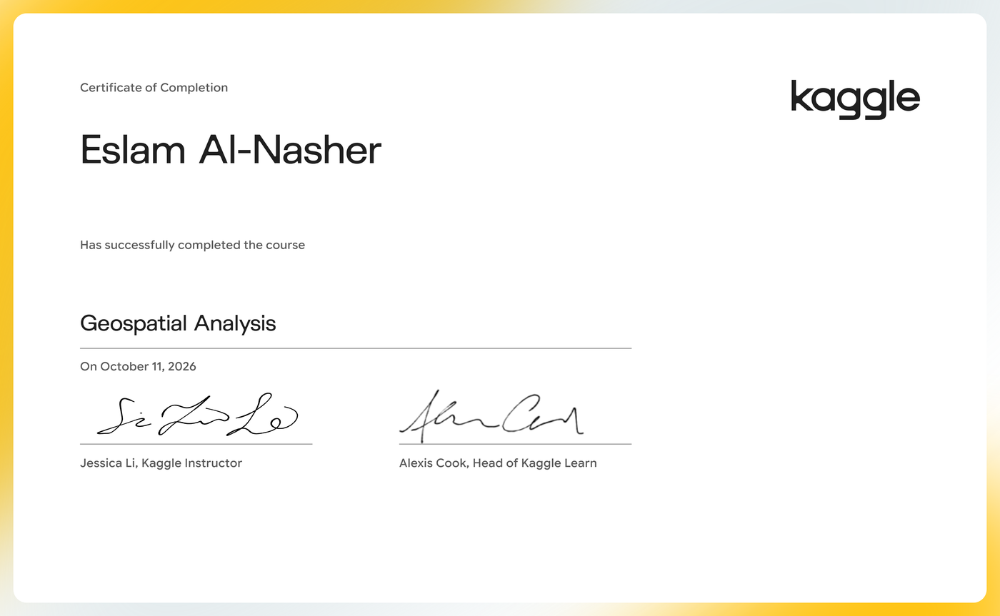</p>
<p align="center"><sub><i>Kaggle · Working with coordinates, spatial joins and map-based analysis.</i></sub></p>

<p align="center">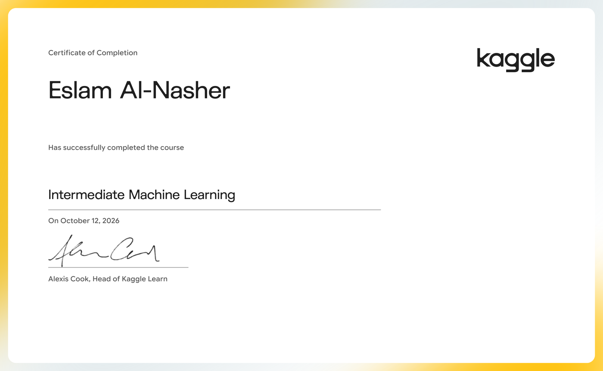</p>
<p align="center"><sub><i>Kaggle · Regularization, trees, ensembles and validation strategies.</i></sub></p>

<p align="center"></p>
<p align="center"><sub><i>Kaggle · Fairness, bias, privacy and responsible model deployment.</i></sub></p>

<p align="center"></p>
<p align="center"><sub><i>Kaggle · Neural networks, backpropagation and training deep models.</i></sub></p>

<p align="center">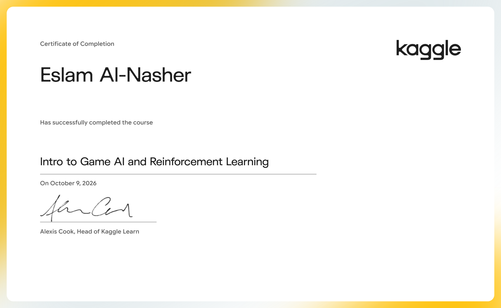</p>
<p align="center"><sub><i>Kaggle · Agents, states, rewards and Q-learning basics.</i></sub></p>

<p align="center"></p>
<p align="center"><sub><i>Kaggle · Core ML workflow — features, training and evaluation.</i></sub></p>

<p align="center">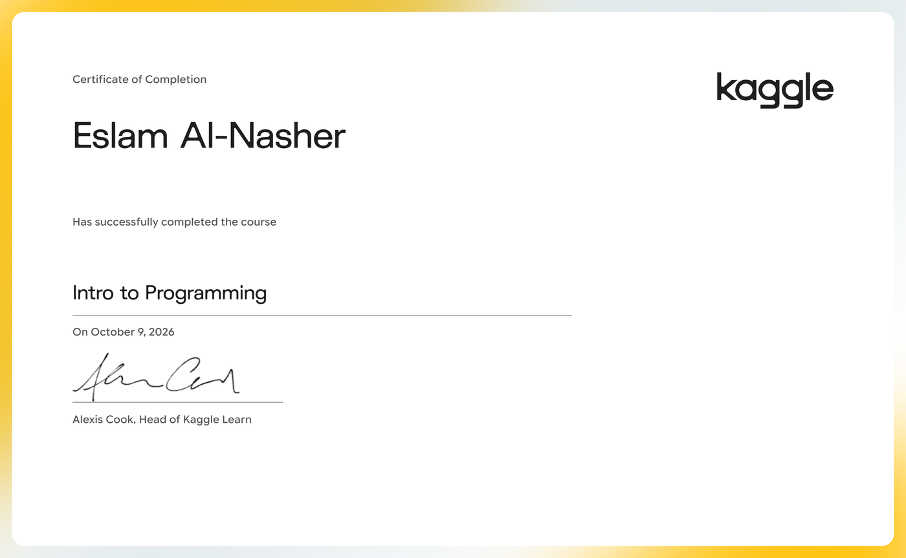</p>
<p align="center"><sub><i>Kaggle · Python fundamentals — variables, functions and control flow.</i></sub></p>

<p align="center"></p>
<p align="center"><sub><i>Kaggle · Core SQL — SELECT, WHERE, GROUP BY and ORDER BY.</i></sub></p>

<p align="center">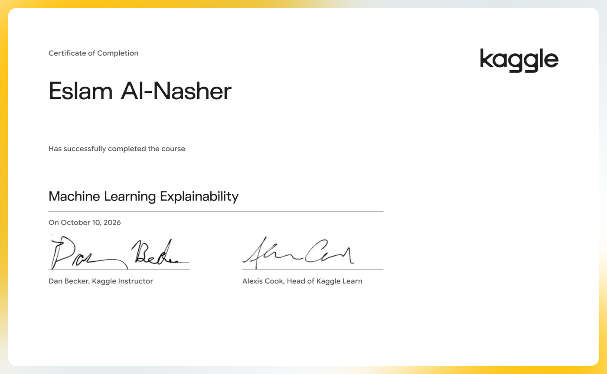</p>
<p align="center"><sub><i>Kaggle · Feature importance, SHAP and interpreting model output.</i></sub></p>

<p align="center">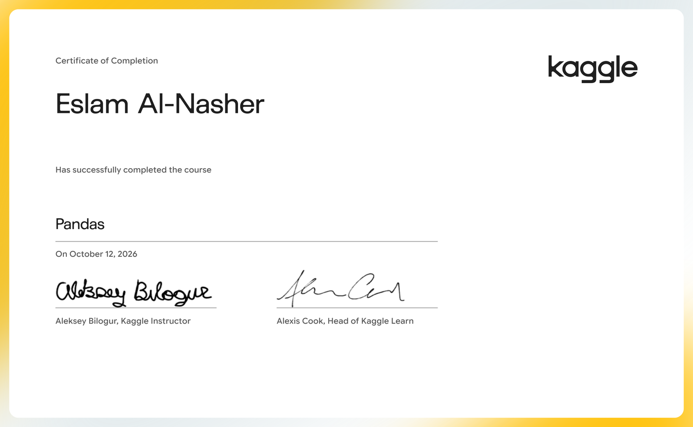</p>
<p align="center"><sub><i>Kaggle · DataFrames, filtering, grouping, joins and cleaning with pandas.</i></sub></p>

<p align="center">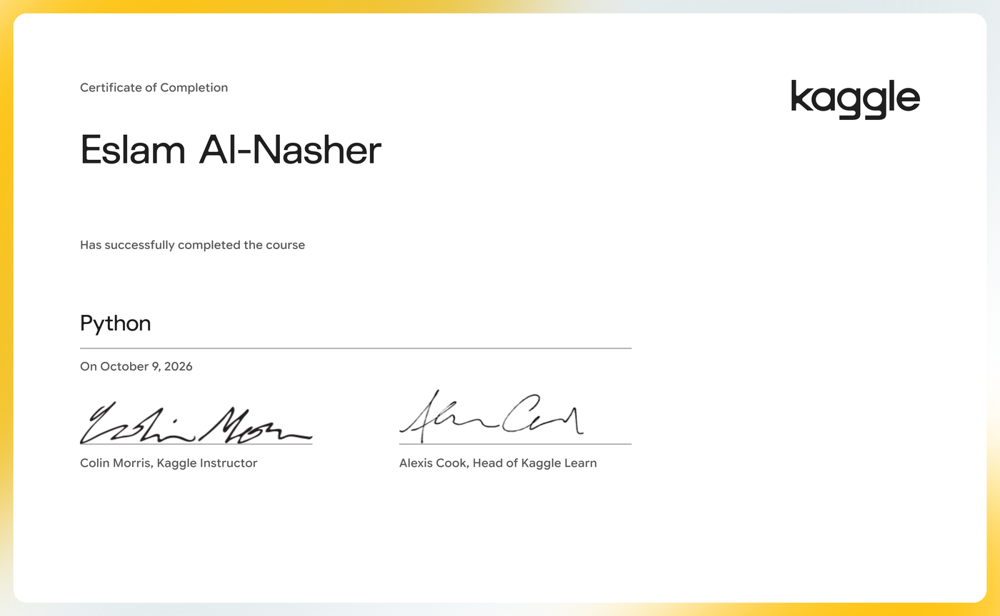</p>
<p align="center"><sub><i>Kaggle · Python for automation, APIs, data work and backend development.</i></sub></p>

<p align="center">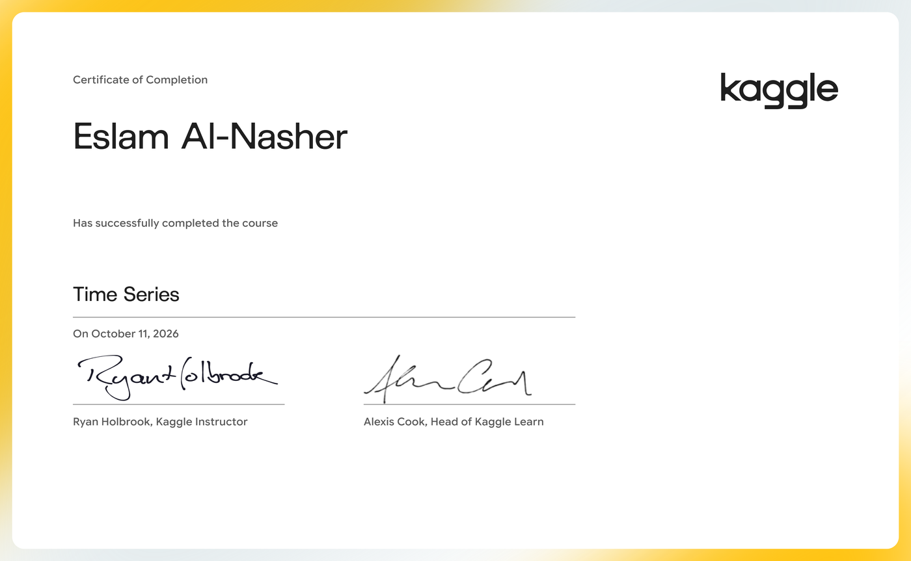</p>
<p align="center"><sub><i>Kaggle · Forecasting, trends, seasonality and time-based validation.</i></sub></p>

### English — OPEN MOOCs

<p align="center">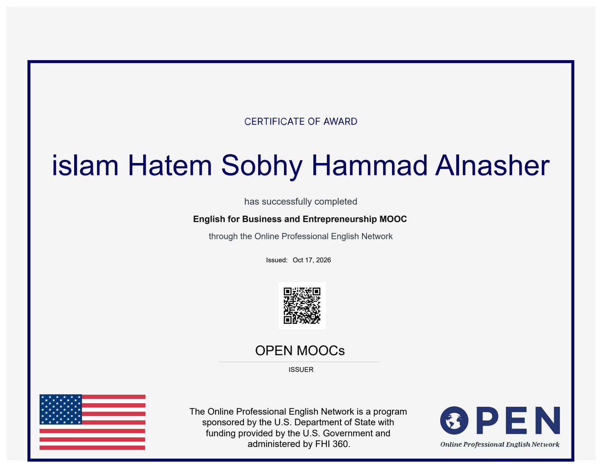</p>
<p align="center"><sub><i><a href="certificates/open-mooc-english-business-entrepreneurship.pdf">PDF original</a></i></sub></p>
<p align="center"><sub><i>OPEN MOOCs (US Dept. of State) · Professional business communication for founders and startups.</i></sub></p>

<p align="center">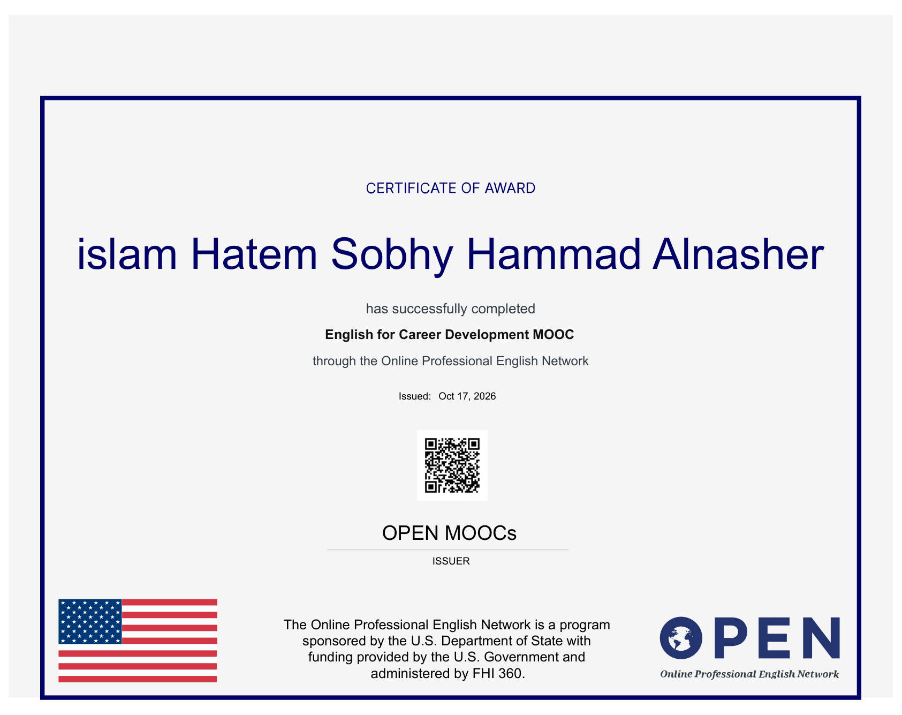</p>
<p align="center"><sub><i><a href="certificates/open-mooc-english-career-development.pdf">PDF original</a></i></sub></p>
<p align="center"><sub><i>OPEN MOOCs (US Dept. of State) · Workplace English for CVs, interviews and professional communication.</i></sub></p>

<p align="center"></p>
<p align="center"><sub><i><a href="certificates/open-mooc-english-tourism-professionals.pdf">PDF original</a></i></sub></p>
<p align="center"><sub><i>OPEN MOOCs (US Dept. of State) · English for tourism, hospitality and travel-facing roles.</i></sub></p>

<!-- CERTS:END -->

---

<div align="center">

## 📬 Let's Build Something

**Have a site, a store, an AI feature, or a security problem worth fixing?**
Tell me what you need — scope, timeline and price are all open.

<br/>

[](mailto:aslamalkarywka@gmail.com)
[](https://github.com/aslamalkarywk7/aslamalkarywk7/issues)
[](https://aslamalkarywk7.github.io/aslamalkarywk7/)

</div>

---

## 📚 Documentation

| Doc | What it covers |
|---|---|
| [docs/tech-stack.md](docs/tech-stack.md) | Full stack map, production vs. explored, all 40 languages |
| [docs/full-stack.md](docs/full-stack.md) | Proof page — backend, live sites, screenshots, pinned versions |
| [docs/qa.md](docs/qa.md) | How I work, my standards, my education |
| [docs/ai-integrations.md](docs/ai-integrations.md) | AI integrations + the assistant on this site |
| [docs/mcp.md](docs/mcp.md) | MCP server for the portfolio knowledge base |
| [docs/defensive-security.md](docs/defensive-security.md) | Defensive security notes |
| [docs/linux-systems.md](docs/linux-systems.md) | Linux, containers, CI/CD |
| [docs/other-skills.md](docs/other-skills.md) | Explored but not production |
| [docs/certificates.md](docs/certificates.md) | All 25 certificates, with PDF originals |
| [CONTRIBUTIONS.md](CONTRIBUTIONS.md) | The open-source story |

### 🛠️ Keeping the docs in sync

Some parts of this repository are generated so the site and the documentation can never disagree. Run the scripts after editing the source they read:

| Script | What it regenerates | Read from |
|---|---|---|
| `node scripts/build-cert-docs.mjs` | the certificates section of this README and of `docs/certificates.md` | `data/certificates.mjs` (the catalogue the website renders) |
| `node scripts/build-corpus.mjs` | `data/docs-corpus.mjs` — the searchable snapshot the AI assistant uses | `README.md` + `docs/*.md` |
| `node scripts/dev.mjs` | nothing — it runs the site and the chat API locally | — |

---

<div align="center">
<sub>© 2026 Islam Al-Nashar · Built from scratch · <a href="LICENSE">MIT License</a></sub>
</div>
